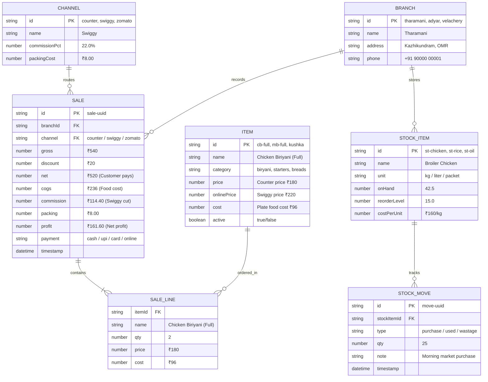
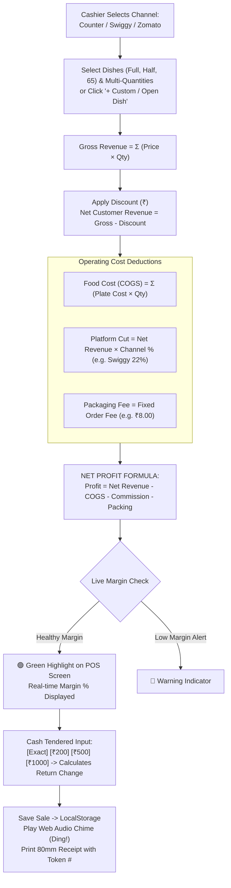
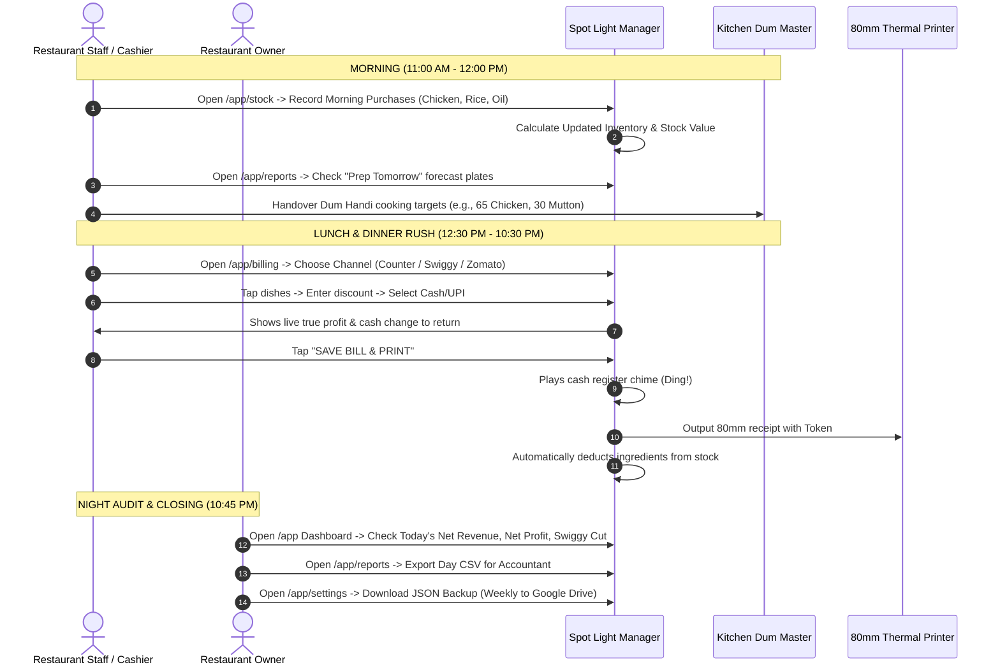
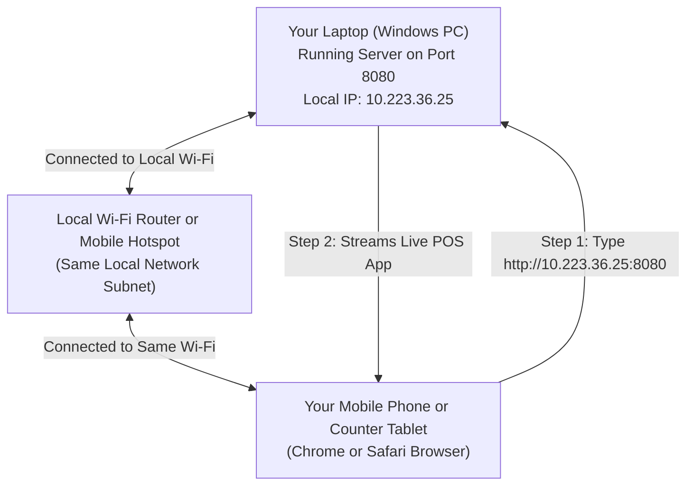

# 🍗 Spot Light Biriyani & POS Suite — Master Guide, Diagrams & Business Playbook

---

## 1. System Architecture & Tech Stack

```mermaid
graph TD
    subgraph Client_Browser ["Client Browser / Counter Tablet"]
        UI["React 19 + TanStack Router UI"]
        subgraph Public_Site ["Public Website (Customer Facing)"]
            Home["/ (Hero, Live Handi Status, WhatsApp Modal)"]
            Menu["/menu (Categorized Dishes & Prices)"]
            Branches["/branches (Tharamani, Adyar, Velachery)"]
            Contact["/contact (Bulk & Catering)"]
        end
        subgraph POS_App ["Spot Light Manager (/app)"]
            Dash["/app (KPIs, Profit Margin, Charts)"]
            Bill["/app/billing (POS Counter, Swiggy, Zomato, Custom Dishes)"]
            Rep["/app/reports (Item breakdown, Prep Forecast)"]
            Stock["/app/stock (Inventory & Waste Movements)"]
            Items["/app/items (Menu & Plate Cost Editor)"]
            Set["/app/settings (Channels, Backup/Restore)"]
        end
        Store["POS Store Engine (src/lib/pos-store.ts)"]
        LocalStorage[("Browser LocalStorage\nKey: slb.pos.v1\n100% Offline Capable")]
    end

    subgraph Peripherals ["Hardware & Integrations"]
        Printer["80mm Thermal Receipt Printer (USB / Bluetooth)"]
        Audio["Web Audio API (Synthesizer Chimes)"]
        WhatsApp["WhatsApp Business Cloud Link"]
    end

    Home --> Store
    Menu --> Store
    Dash --> Store
    Bill --> Store
    Rep --> Store
    Stock --> Store
    Items --> Store
    Set --> Store

    Store <--> LocalStorage
    Bill -->|Browser Print Dialog| Printer
    Bill -->|Sound Chime| Audio
    Home -->|Direct Order| WhatsApp
```



---

## 2. Complete Entity Relationship Data Model (ERD)



---

## 3. Order & True Profit Calculation Flowchart



---

## 4. End-to-End Daily Restaurant Workflow



---

## 5. Local Network & Mobile Phone Architecture



---

## 6. Directory Layout of the Master Codebase

```
spotlight-biriyani/
├── public/                     Static web assets
│   ├── favicon.svg             Glowing brand flame SVG icon
│   └── favicon.ico             32x32 browser tab icon
│
├── src/
│   ├── routes/                 TanStack Router (File-based routes)
│   │   ├── __root.tsx          Master Shell (Fonts, Favicons, Sonner toaster)
│   │   ├── index.tsx           Homepage (Live Handi banner, WhatsApp modal, Buckets, Reviews)
│   │   ├── menu.tsx            Public menu (Reads live prices from POS store)
│   │   ├── branches.tsx        Kitchen locations with Google Maps directions
│   │   ├── contact.tsx         Bulk catering inquiry form
│   │   │
│   │   ├── app.tsx             POS App Shell (Branch dropdown, navigation tabs)
│   │   ├── app.index.tsx       Manager Dashboard (Revenue, Food Cost, Net Profit %)
│   │   ├── app.billing.tsx     Fast touch billing terminal, multi-item counters, custom items, receipts
│   │   ├── app.reports.tsx     Item sales counts, P&L breakdown & Prep Forecast
│   │   ├── app.stock.tsx       Raw materials (Chicken, Rice, Oil) on hand & wastage
│   │   ├── app.items.tsx       Menu & Cost Editor (Counter price, Swiggy price, Plate cost)
│   │   └── app.settings.tsx    Branch names, Swiggy/Zomato commission %, JSON Backup
│   │
│   ├── lib/
│   │   └── pos-store.ts        THE CORE ENGINE: Database, profit math, storage, demo seed data
│   │
│   ├── components/site/
│   │   └── SiteShell.tsx       Public website navigation header & footer
│   │
│   ├── assets/                 Food photography (Biriyani, Mutton, Kushka)
│   └── styles.css              All design tokens (Embers & Charcoal OKLCH color palette)
│
└── docs/
    ├── user-manuals/           Dedicated Step-by-Step Operating Manuals
    │   ├── 1_RESTAURANT_OWNER_MANUAL.md
    │   ├── 2_MANAGER_AND_CASHIER_MANUAL.md
    │   ├── 3_DEVELOPER_AND_ADMIN_A_TO_Z_GUIDE.md
    │   ├── 4_WHITE_LABEL_REBRANDING_GUIDE.md
    │   └── printable-pdf-html/ (Printable HTML files ready to save as PDF via Ctrl + P)
    │
    └── delivery/               14 Client proposals, pricing sheets, sales pitch decks (English, Tamil, Hindi)
```

---

## 7. Dedicated User Manuals & Printable PDF Files

All manuals are organized inside [docs/user-manuals/](file:///c:/Users/ManikandanSoundar/OneDrive%20-%20Adeahub/Personal%20Work/spotlight-biriyani-full-kit/spotlight-biriyani/docs/user-manuals):

1. **[1_RESTAURANT_OWNER_MANUAL.md](file:///c:/Users/ManikandanSoundar/OneDrive%20-%20Adeahub/Personal%20Work/spotlight-biriyani-full-kit/spotlight-biriyani/docs/user-manuals/1_RESTAURANT_OWNER_MANUAL.md)**
   - *For the Owner*: Daily morning to night routine, how to check true profit, stop Swiggy leakage, and download Sunday backups.
   - *Printable PDF*: [1_RESTAURANT_OWNER_MANUAL.html](file:///c:/Users/ManikandanSoundar/OneDrive%20-%20Adeahub/Personal%20Work/spotlight-biriyani-full-kit/spotlight-biriyani/docs/user-manuals/printable-pdf-html/1_RESTAURANT_OWNER_MANUAL.html)

2. **[2_MANAGER_AND_CASHIER_MANUAL.md](file:///c:/Users/ManikandanSoundar/OneDrive%20-%20Adeahub/Personal%20Work/spotlight-biriyani-full-kit/spotlight-biriyani/docs/user-manuals/2_MANAGER_AND_CASHIER_MANUAL.md)**
   - *For the Cashier / Counter*: Step-by-step billing, ordering multiple dishes (1 full, 1 half, 1 65), adding custom off-menu dishes, using quick cash tender chips, and printing 80mm thermal receipts with token numbers.
   - *Printable PDF*: [2_MANAGER_AND_CASHIER_MANUAL.html](file:///c:/Users/ManikandanSoundar/OneDrive%20-%20Adeahub/Personal%20Work/spotlight-biriyani-full-kit/spotlight-biriyani/docs/user-manuals/printable-pdf-html/2_MANAGER_AND_CASHIER_MANUAL.html)

3. **[3_DEVELOPER_AND_ADMIN_A_TO_Z_GUIDE.md](file:///c:/Users/ManikandanSoundar/OneDrive%20-%20Adeahub/Personal%20Work/spotlight-biriyani-full-kit/spotlight-biriyani/docs/user-manuals/3_DEVELOPER_AND_ADMIN_A_TO_Z_GUIDE.md)**
   - *For You (Developer / Admin)*: Starting/stopping server, finding your Wi-Fi IP, opening on mobile phones, free cloud deployment on Vercel/Netlify.
   - *Printable PDF*: [3_DEVELOPER_AND_ADMIN_A_TO_Z_GUIDE.html](file:///c:/Users/ManikandanSoundar/OneDrive%20-%20Adeahub/Personal%20Work/spotlight-biriyani-full-kit/spotlight-biriyani/docs/user-manuals/printable-pdf-html/3_DEVELOPER_AND_ADMIN_A_TO_Z_GUIDE.html)

4. **[4_WHITE_LABEL_REBRANDING_GUIDE.md](file:///c:/Users/ManikandanSoundar/OneDrive%20-%20Adeahub/Personal%20Work/spotlight-biriyani-full-kit/spotlight-biriyani/docs/user-manuals/4_WHITE_LABEL_REBRANDING_GUIDE.md)**
   - *For Business Scaling*: How to adapt this software for ANY restaurant (Chai cafe, burger joint, Mandi shop) in 15 minutes, pricing models, pitch scripts, and financial models.
   - *Printable PDF*: [4_WHITE_LABEL_REBRANDING_GUIDE.html](file:///c:/Users/ManikandanSoundar/OneDrive%20-%20Adeahub/Personal%20Work/spotlight-biriyani-full-kit/spotlight-biriyani/docs/user-manuals/printable-pdf-html/4_WHITE_LABEL_REBRANDING_GUIDE.html)
