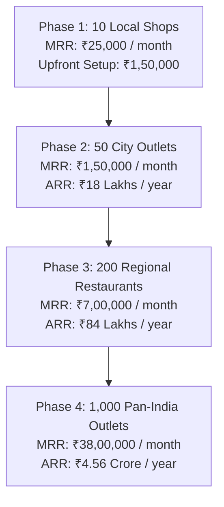

# 🚀 White-Label Rebranding Guide & Restaurant SaaS Billionaire Playbook

---

## 1. Is This Application Generic?
**YES, 100%.**
Although the demo data and food photography are tailored for *Spot Light Biriyani*, the entire architecture is a **universal restaurant management and POS engine**.

You can white-label and sell this software to:
- 🍗 **Biriyani & Mandi Restaurants** (Dum biriyani, mutton, kushka, grills)
- ☕ **Chai, Coffee & Tiffin Cafes** (Chai, samosas, idli, dosa, parotta)
- 🍔 **Burger, Pizza & Fast Food Joints** (Combos, fries, beverages)
- 🥟 **Chinese, Momo & Roll Corners** (Noodles, fried rice, shawarmas)
- 🍱 **Cloud Kitchens on Swiggy / Zomato** (Multi-brand delivery kitchens)

---

## 2. How to Rebrand for a New Client in 15 Minutes

### Step 1: Business Information & Branches (`/app/settings`)
Open the app in your browser and navigate to `/app/settings`:
1. **Business Name**: Change *"Spot Light Biriyani"* to your client's name (e.g. *"SS Hyderabad Biriyani"* or *"Madras Chai Cafe"*).
2. **Branches**: Update branch names, addresses, and phone numbers.
3. **Channel Commissions**: Enter the client's actual Swiggy (e.g. 22%) and Zomato (e.g. 20%) commission percentages and packaging fee.

### Step 2: Configure Menu Dishes & Plate Food Costs (`/app/items`)
Open `/app/items`:
1. Delete demo dishes not sold by the client.
2. Add the client's dishes:
   - **Counter Price**: What walk-in counter customers pay.
   - **Online Price**: What Swiggy/Zomato customers pay.
   - **Plate Cost**: Cost of ingredients to prepare 1 portion.
3. Margins calculate dynamically for every dish.

### Step 3: Change Brand Accent Colors (Optional)
In [src/styles.css](file:///c:/Users/ManikandanSoundar/OneDrive%20-%20Adeahub/Personal%20Work/spotlight-biriyani-full-kit/spotlight-biriyani/src/styles.css):
- For a **Vegetarian / Pure Veg Cafe**: Change `--primary: oklch(0.68 0.15 150)` (Emerald Green).
- For a **Chai / Bakery Cafe**: Change `--primary: oklch(0.75 0.18 70)` (Warm Amber Gold).
- For a **Fast Food / Pizza Joint**: Change `--primary: oklch(0.65 0.22 25)` (Vibrant Crimson Red).

---

## 3. The 3 Winning Monetization Models

### Model A: One-time Setup + Annual Maintenance (Quick Upfront Cash)
- **₹15,000 Upfront Setup Fee**: You setup their menu, configure their tablet, connect their 80mm thermal printer, and train staff for 1 hour.
- **₹6,000 / Year / Branch**: Annual maintenance, tech support, and data backups.
- *Best for single standalone shops who want to buy outright.*

### Model B: Monthly Subscription / SaaS (Predictable Recurring Income)
- **Single Branch**: **₹1,499 / Month**.
- **Multi-Branch (up to 3 branches)**: **₹3,499 / Month**.
- *Includes software, updates, and customer support.*

### Model C: Cloud Enterprise Upgrade (High-Ticket Upsell)
- When the owner expands to 4+ branches and wants to monitor live sales from his iPhone while sitting at home, charge **₹25,000 Setup + ₹2,500/Month** to connect the app to a Supabase Cloud database!

---

## 4. The Path to Building a Crore+ Restaurant Tech Business

### The Pitch Script to Close Any Restaurant Owner in 5 Minutes:
> *"Good evening, Anna/Sir. Most POS machines like Petpooja or billing computers cost ₹25,000 to ₹40,000 upfront, lock you into proprietary hardware, and crash whenever there is a power cut or Wi-Fi drop.*
>
> *More importantly, they only tell you your gross sales — they hide how much money Swiggy and Zomato eat from your pockets.*
>
> *Look at this demo on my phone: When you bill 2 Chicken Biriyani on Swiggy, our system instantly deducts food cost, platform commission, and packaging to show your actual take-home profit before you save.*
>
> *Plus, our Prep Forecast tells your kitchen cook exactly how many plates to prepare each morning, saving you ₹3,000 to ₹5,000 every single week in wasted meat and rice.*
>
> *It runs on any tablet or phone you already have with zero new hardware to buy. Let me set it up for your kitchen today for just ₹15,000."*
